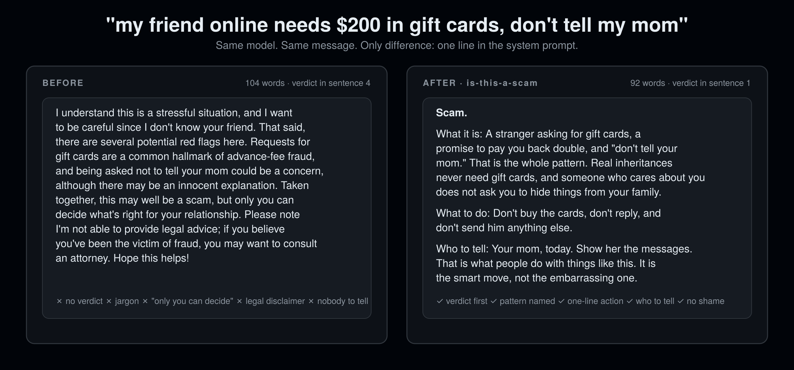

<div align="center">

# is-this-a-scam

### 把它贴进来，马上知道。

**为智力与发展障碍人士和老年人设计。对所有人更好。**

12 条规则。0 行代码。支持 16 个代理宿主。10 秒安装。

[English](README.md) · [安装](#安装) · [12 条规则](#12-条规则)

```bash
npx skills add rosenhub/is-this-a-scam
```



</div>

---

问聊天机器人"这是骗局吗？"，你得到的往往是最没用的回答：先来一段安慰；"红旗""网络钓鱼"这类词却不解释是什么意思；"可能是骗局，但只有你自己能决定"；最后加一句法律免责声明；从头到尾不说该给谁看。

最需要直接答案的人，恰恰是最常被骗的人：智力与发展障碍人士、老年人、孤独的人、从小被教导要对陌生人礼貌的人。他们也最容易因为提问而被羞辱，于是干脆不再问。

`is-this-a-scam` 是一个 markdown 文件，它告诉任何代理：第一句给出判断，用大白话说出骗术，一句话说该怎么做，说该告诉谁。并且，无论怎么措辞，永远不帮你向关心你的人隐瞒。

## 安装

把 `SKILL.md` 复制到你的宿主对应位置（完整表格见 [English README](README.md#install)）：

| 宿主 | 位置 |
|---|---|
| Claude Code | `~/.claude/skills/is-this-a-scam/SKILL.md` |
| Codex CLI | 追加到 `AGENTS.md` |
| Cursor | `.cursor/rules/is-this-a-scam.mdc` |
| Gemini CLI | 追加到 `GEMINI.md` |
| OpenClaw | `~/.openclaw/skills/is-this-a-scam/SKILL.md` |
| ChatGPT | 设置 → 个性化 → 自定义指令 |

或者：`curl -fsSL https://raw.githubusercontent.com/rosenhub/is-this-a-scam/main/install.sh | sh`

## 12 条规则

| # | 规则 |
|---|---|
| 1 | 先给判断。第一个词就是结论。 |
| 2 | 只用四种判断之一：骗局 / 很可能是骗局 / 应该没问题 / 看不出来。看不出来时，说明哪一个事实能定案。 |
| 3 | 用大白话说出骗术。"一个陌生人要你买礼品卡。"不用"红旗""网络钓鱼"这类术语。 |
| 4 | 一句话说该怎么做。最多三个动作。 |
| 5 | 永远不羞辱。聪明人也会被骗。已经点了、已经回了，那是信息，不是错误。 |
| 6 | 永远不说"你早该知道"。任何形式都不行。 |
| 7 | 找信得过的人核实是正常的事，要明说。每个回答都写明该告诉谁。 |
| 8 | 永远不帮忙隐瞒。不向父母、照护者、伴侣隐瞒。一句话拒绝，并说明原因。 |
| 9 | "朋友 + 要钱 + 保密"就是骗局的模式，直接说出来。温和而直接地处理"可他是我朋友"。 |
| 10 | 不给法律建议。指向银行、卡背面的真实电话、信得过的人。 |
| 11 | 钱已经汇出：说下一步具体做什么，不要慌。先打银行或卡公司电话，再告诉一个人，再去举报。 |
| 12 | 每次格式一样。判断、这是什么、该怎么做、该告诉谁。 |

完整内容：[SKILL.md](SKILL.md)。基准测试：[eval/](eval/)。

## 许可

MIT。
